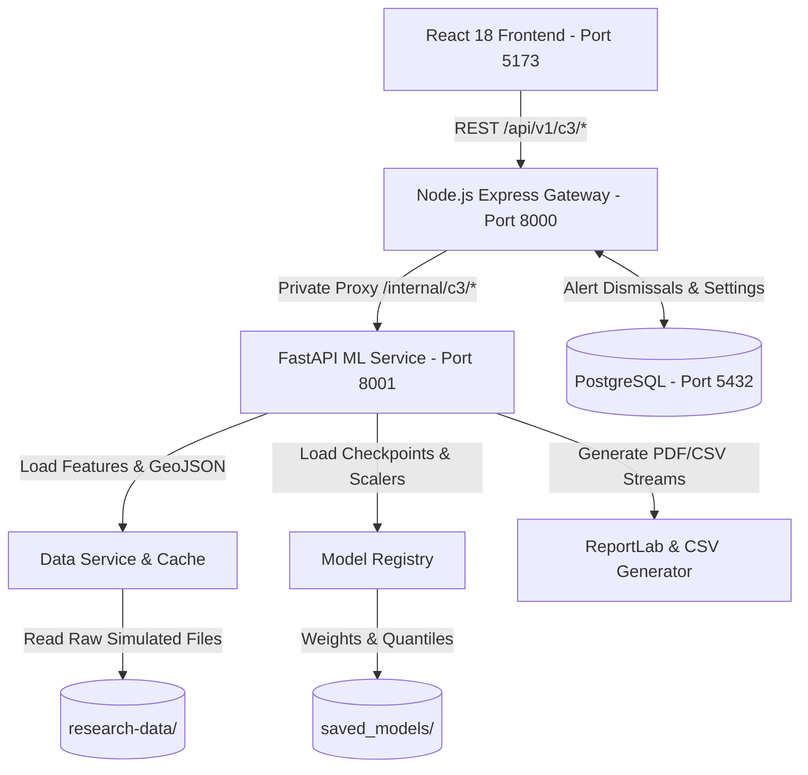

# CoconutRisk AI — Component 03 Architecture

## Monorepo Architecture Overview

Component 03 (Water Stress, Drought and Future Forecast Risk Modelling) is structured as a modular, three-tier service monorepo:

```text
coconutrisk-ai/
├── frontend/               # React 18 + Vite + Tailwind + Recharts + Leaflet
├── api/                    # Node.js 20+ Express Gateway + PostgreSQL (pg pool)
│   ├── src/controllers/c3.controller.js
│   ├── src/routes/c3.routes.js
│   ├── src/db/index.js     # PostgreSQL Pool & Schema Migrations
│   ├── src/models/{C3Alert.js, C3ReportJob.js}
│   ├── src/services/c3MLClient.js
│   └── src/app.js
├── ml-service/             # Python 3.10+ FastAPI + PyTorch + XGBoost
│   ├── app/main.py
│   ├── app/routers/c3.py
│   ├── app/schemas.py
│   ├── app/services/{data_service.py, forecast_service.py, model_registry.py, report_generator.py}
│   ├── training/{prepare.py, train_baselines.py, train_classical.py, train_sarimax.py, train_deep.py, make_intervals.py, evaluate.py, train_all.py}
│   └── saved_models/       # 24 model artifacts (joblib, pt), preprocessors, metrics JSON
├── research-data/          # 525,952 daily records, 17,280 monthly history, 9,600 ML rows
├── scripts/                # smoke_test.py, train_all.py, etc.
└── docs/                   # Contract, architecture, integration, data warning
```

## Data Flow & Service Isolation



## Scientific Scope & Boundaries
1. **Component 03 Scope:** Predicts meteorological drought index (SPI-3) at horizons 1M, 3M, and 6M ahead based exclusively on environmental time-series.
2. **Boundary against C1/C2/C4:**
   - C1: Coconut crop yield and national export value forecasting.
   - C2: Computer vision drone/field diagnostics of visible crown yellowing.
   - C4: Cellular spatial disease propagation vectors.
   - C3 does NOT infer disease or measure direct internal tree xylem water pressure.
3. **Data Authenticity:** The 1981–2025 dataset is 100% synthetic simulation. Fixed 1981–2010 gamma parameters establish the baseline reference.

## Port Assignments
- Frontend: `5173`
- Express API Gateway: `8000`
- Python FastAPI ML Service: `8001`
- PostgreSQL: `5432`
